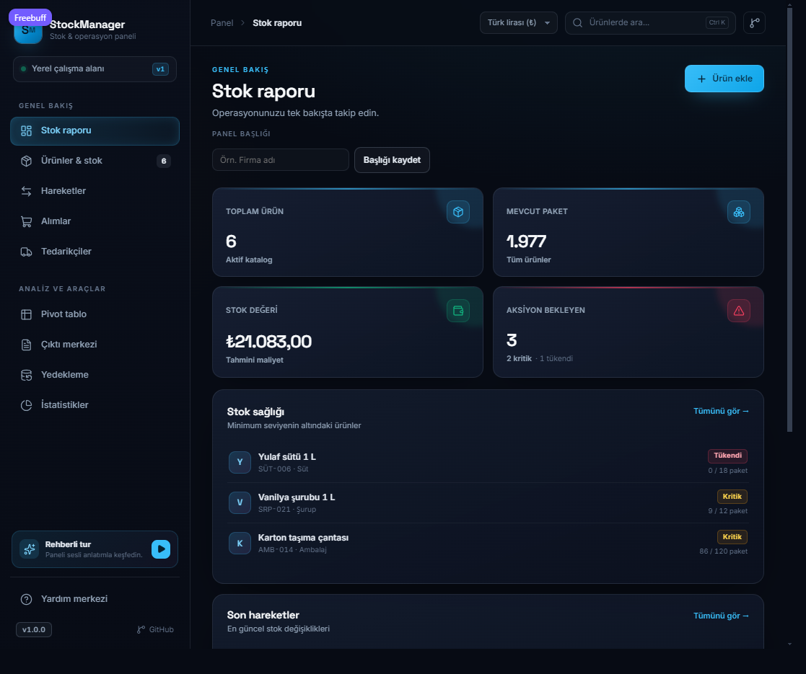

# StockManager

Ürün, stok, hareket, alım ve rapor yönetimi için koyu temalı, Türkçe operasyon paneli. Aynı kaynak iki biçimde çalışır:

- **Web sürümü:** https://cehennemgibiyim.github.io/StockManager/
- **Windows kurulum paketi:** [GitHub Releases](https://github.com/CehennemGibiyim/StockManager/releases/latest)

Tüm veriler yerel kalır; bulut hesabı, giriş veya sunucu gerekmez. Web sürümünde tarayıcı `localStorage`, Windows uygulamasında aynı depolama Electron'un yerel profilinde tutulur.

## Ekran görüntüsü



## Özellikler

- Personel26 esintili cam panel arayüzü, Lucide ikonları, Inter + Space Grotesk tipografi.
- Ürün ekleme, düzenleme, silme; stok kodu, kategori, alt limit ve birim fiyat takibi.
- Stok giriş/çıkış hareketleri ve otomatik stok güncellemesi.
- Alım kayıtları, tedarikçi özetleri ve maliyet hesapları.
- Kritik/tükenen ürün uyarıları, kategori pivot tablosu ve istatistik grafikleri.
- CSV dışa aktarma, A4 yazdırma, JSON yedekleme ve geri yükleme.
- Windows'ta otomatik yedekleme: açılışta, 5 dakikada bir, kapanışta ve manuel yedekte kurulum klasöründeki `backups` dizinine yazar. Son 7 gün saklanır, 8. güne giren dosyalar silinir.
- Yardım merkezi: 5 resimli kılavuz, numaralı ekran görüntüsü işaretleri ve adım listesi.
- Türkçe sesli anlatımlı 9 adımlı rehber turu. Ses kapalıysa altyazı ve zamanlayıcıyla ilerler.
- Yardım > Sürüm notları içinde güncelleme denetimi: yeni sürüm varsa doğrudan en yenisine geçer, istenirse sürüm atlanır.

## Geliştirme

Gereksinim: Node.js 20 veya üzeri.

```bash
npm install
npm run dev          # http://localhost:5173
```

TypeScript kaynağı `src/main.ts`, stil `styles.css`, yardım merkezi `help.js` ve `help/guides.json` içindedir. `main.js` derlenmiş çıktıdır; doğrudan düzenlemeyin.

```bash
npm run typecheck    # tip kontrolü
npm run build:js     # src/main.ts -> main.js
npm run build:web    # statik site -> dist/web
npm run start:desktop
```

## Windows kurulum paketi

```bash
npm run dist:win
```

Çıktı: `release/StockManager-Setup-<sürüm>.exe`. NSIS kurulumu kurulum klasörünü seçmeye izin verir, masaüstü ve başlat menüsü kısayolları oluşturur. Kaldırma sırasında kullanıcı verileri silinmez.

Kurulum paketi imzasız olduğu için ilk açılışta Windows SmartScreen uyarısı gösterebilir. **Daha fazla bilgi → Yine de çalıştır** ile devam edilebilir.

## Yedekleme ve güncelleme

Masaüstü sürümü verileri yerel profilinde tutar; yedekleri ise kurulum klasörünün yanındaki `backups` dizinine yazar. Varsayılan kullanıcı kurulumunda bu yol `%LOCALAPPDATA%\Programs\StockManager\backups` olur; kurulum sırasında başka bir klasör seçtiyseniz yedekler oradadır:

- Uygulama açılırken, her 5 dakikada bir, kapanırken ve **Yedeği şimdi al** düğmesine basıldığında zaman damgalı JSON yedeği oluşur.
- Her yedeğin yanında son yedeği taşıyan `latest.json` güncellenir. Yerel veri boşsa uygulama açılışta bu dosyayı kendiliğinden geri yükler.
- Bugün dahil son 7 takvim günü saklanır; 8. güne giren eski yedekler açılışta ve her yedeklemede otomatik silinir.
- Yedekleme ekranındaki **Yedekten geri yükle** ile önceki dosyalardan biri seçilebilir; **Yedek klasörünü aç** ile klasör görüntülenir.
- Web sürümünde tarayıcı indirmesi kullanılır; otomatik klasör yedeklemesi yalnızca Windows uygulamasında çalışır.

Yardım > Sürüm notları bölümündeki **Güncellemeleri denetle** düğmesi GitHub'daki en güncel sürümü okur. Yeni sürüm varsa ara sürümler atlanır, kurulum paketi uygulama içinden indirilip kurulum sihirbazı açılır. **Bu sürümü atla** seçeneği yalnızca o sürümü gizler; daha yeni bir sürüm çıktığında denetim yeniden gösterilir.

## Yeni sürüm ve sürüm notu

Her değişiklikten sonra tek komutla sürümü yükseltip notları yazabilir ve güncel kurulum paketini üretebilirsiniz:

```bash
npm run release -- --patch --notes "Ürün arama hızlandırıldı|Yeni stok uyarıları eklendi"
```

- `--patch`, `--minor`, `--major`: sürüm seviyesi (varsayılan `patch`).
- `--notes "a|b|c"` veya `--notes-file notlar.txt`: sürüm notları.
- `--no-installer`: yalnızca web sürümünü derler.
- `npm run release:same -- --notes "..."`: sürüm numarasını değiştirmeden paketi yeniler.

Komut şunları yapar:

1. `package.json` ve `version.json` sürümünü günceller.
2. `CHANGELOG.md` dosyasına tarihli sürüm notu ekler.
3. `dist/web` statik çıktısını üretir.
4. `release/StockManager-Setup-<sürüm>.exe` kurulum paketini oluşturur.
5. `release/latest.json` dosyasına sürüm ve indirme bilgisini yazar.

Ardından sürümü etiketleyip gönderin:

```bash
git add -A
git commit -m "Sürüm v1.1.0: otomatik yedekleme ve uygulama içi güncelleme"
git tag v1.1.0
git push origin main --tags
```

`v*` etiketi GitHub Actions üzerinde Windows kurulum paketini üretir ve Releases sayfasına yükler. `main` dalına yapılan push ise web sürümünü GitHub Pages'e yayınlar.

## GitHub Pages

Depo ayarlarında **Settings → Pages → Build and deployment → Source: GitHub Actions** seçili olmalıdır. `.github/workflows/pages.yml` her push'ta `dist/web` klasörünü yayınlar. Adres: `https://cehennemgibiyim.github.io/StockManager/`.

## Proje yapısı

```text
index.html               Uygulama kabuğu
styles.css               Tema ve responsive düzen
src/main.ts              TypeScript kaynak (veri, görünümler, formlar)
main.js                  Derlenmiş uygulama
help.js                  Yardım merkezi, kılavuz modalı, sesli tur
help/guides.json         Kılavuz adımları ve tur metinleri
assets/help/*.png        Gerçek panel ekran görüntüleri
assets/fonts, vendor     Yerel fontlar ve Lucide
electron/main.cjs        Masaüstü kabuk, sabit origin ve IPC
electron/bridge.js       Masaüstü yedekleme/güncelleme arayüz köprüsü
electron/backup.cjs       Yedek dizini, yazma ve saklama temizliği
electron/lib.cjs          Saf yedek/sürüm yardımcıları
electron/updater.cjs      GitHub sürüm denetimi ve kurulum indirme
scripts/build-web.mjs    dist/web üretimi
scripts/release.mjs      Sürüm + installer akışı
version.json             Güncel sürüm, notlar, indirme bağlantısı
```

## Veri ve gizlilik

- Web sürümünde veriler yalnızca tarayıcının yerel depolamasında tutulur.
- Windows sürümünde veriler Electron kullanıcı profilinde tutulur; otomatik yedekler kurulum klasöründeki `backups` dizinine yazılır.
- Dışarıya veri gönderilmez, analitik veya takip kodu yoktur. Güncelleme denetimi yalnızca GitHub'daki sürüm dosyasını okur.
- Yedekleme ekranından JSON yedeği alıp başka bilgisayarda geri yükleyebilirsiniz.

## Lisans

MIT
